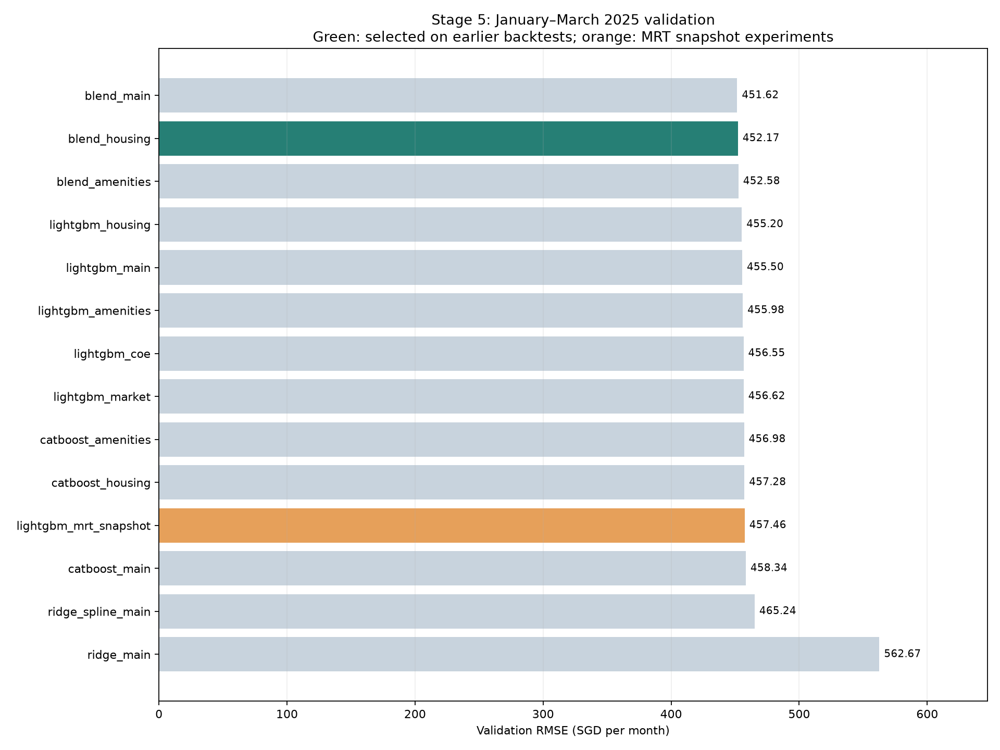
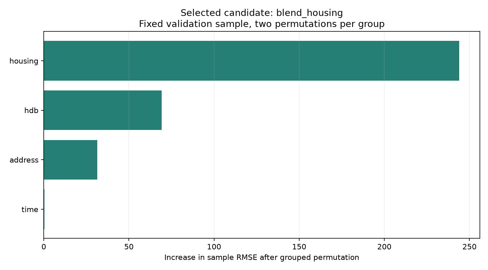
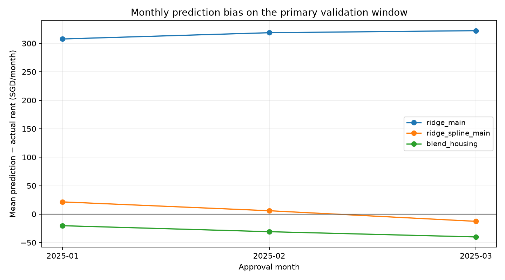

# Stage 5: Feature Expansion and Model Optimisation

## Validation and selection rules

- Candidates are selected on the pooled RMSE of two earlier windows, 2024-07 to 2024-09 and 2024-10 to 2024-12.
- 2025-01 to 2025-03 is the main validation window and is not used to select models, early-stopping rounds, blend weights or features. Earlier experiments have viewed it, so it is not an untouched final test set.
- CatBoost and LightGBM hold out the last 3 months inside each outer training set for early stopping, then refit on the whole outer training set with the selected rounds.
- The blend is fixed at 50% CatBoost / 50% LightGBM on the same features; weights are not tuned on the main validation.
- All macro features are lagged by two months, and outer and inner validations freeze available source months at their own training cut-off. COE and stock values of future validation months are never used.

## Main temporal validation

| Candidate | RMSE | MAE | Mean prediction bias | Selected on earlier windows |
| --- | ---: | ---: | ---: | --- |
| blend_main | 451.6188 | 329.2781 | -23.72 |  |
| blend_housing | 452.1702 | 331.1601 | -30.59 | yes |
| blend_amenities | 452.5783 | 330.8470 | -28.19 |  |
| lightgbm_housing | 455.1987 | 332.9281 | -26.55 |  |
| lightgbm_main | 455.5022 | 331.9834 | -19.66 |  |
| lightgbm_amenities | 455.9756 | 332.5209 | -20.01 |  |
| lightgbm_coe | 456.5514 | 332.9769 | -16.86 |  |
| lightgbm_market | 456.6153 | 332.6809 | -18.69 |  |
| catboost_amenities | 456.9819 | 335.6525 | -36.38 |  |
| catboost_housing | 457.2788 | 336.0324 | -34.63 |  |
| lightgbm_mrt_snapshot | 457.4575 | 333.1983 | -18.97 |  |
| catboost_main | 458.3400 | 335.7604 | -27.79 |  |
| ridge_spline_main | 465.2389 | 335.5900 | +4.65 |  |
| ridge_main | 562.6666 | 406.7216 | +316.44 |  |

## Interpretation

- The candidate selected on earlier windows is blend_housing. Its main validation RMSE is 452.1702 against 562.6666 for same-environment Ridge, an improvement of 19.64%.
- Mean prediction bias changes from +316.44 for Ridge to -30.59 for the candidate. Positive values mean overpredicted rent.
- Model and feature selection details are in selection_backtests.csv. The lowest main-validation score need not be the candidate selected on earlier windows; the difference is kept to avoid post-hoc reselection.

## Main feature groups

| Feature group | RMSE increase after permutation |
| --- | ---: |
| housing | 243.8911 |
| hdb | 69.1611 |
| address | 31.4140 |
| time | 0.4464 |

Importance comes from grouped permutation on a fixed main-validation sample, repeated twice. It is for interpretation only and not used for feature selection. Correlated features can substitute for each other, so it is not a causal effect.

## Temporal, macro and data limitations

- The mrt_snapshot variant is exploratory only and excluded from recommended selection because historical opening dates are missing. Schools, malls and some block attributes are also static snapshots.
- Monthly COE uses the mean premium across rounds and total bids / total quota. Stocks use equal-weight monthly returns of unadjusted CLOSE, mean daily volatility, share of rising securities and security coverage, without filling future prices.
- The macro tables have no true publication dates. The two-month lag is a conservative availability assumption, not a no-leakage guarantee. Corporate actions such as splits may cause jumps in unadjusted prices.
- Frozen macro values can be constant within a validation window, and future time fields can fall into the same tree leaves. Near-zero local permutation importance does not mean these variables had no role in training.
- FEE and FURNISHED have no variation in the current data, so no fee or furnishing flags are added.
- Quarterly validation does not guarantee performance over the long horizon to 2026-07; stage 6 needs longer-window evaluation and the final submission.
- This round only tunes boosting rounds under preset parameters. If early stopping reaches the search cap, a higher-cap robustness check is needed; the parameters cannot be claimed globally optimal.
- No test labels were read and no new competition submission was generated or uploaded. Saved models are diagnostic models at the main-validation cut-off, not final full-data models.

## Outputs

results.csv stores all outer experiments; group_errors.csv stores errors by town, flat type, flat model, floor area, flat age, month, region and address-match status.
group_permutation_importance.csv holds candidate feature-group importance. native_feature_importance.csv holds tree training importance (CatBoost PredictionValuesChange, LightGBM gain); raw values are not comparable across algorithms.

Model APIs follow the [CatBoost documentation](https://catboost.ai/docs/en/concepts/python-reference_catboostregressor) and the [LightGBM documentation](https://lightgbm.readthedocs.io/en/stable/pythonapi/lightgbm.LGBMRegressor.html).

## Group error diagnostics for the selected candidate

These tables describe the main validation only and are not used to reselect models. Towns with at least 100 records are filtered and the 4 with the highest error are listed, to avoid ranking tiny samples.

| Town | Validation rows | RMSE | Mean prediction bias |
| --- | ---: | ---: | ---: |
| jurong west | 620 | 548.76 | +22.40 |
| kallang/whampoa | 342 | 541.49 | -3.83 |
| bukit merah | 530 | 508.53 | -62.77 |
| toa payoh | 341 | 498.81 | -55.47 |

| Flat type | Validation rows | RMSE | Mean prediction bias |
| --- | ---: | ---: | ---: |
| 1-room | 4 | 204.14 | -39.69 |
| 2-room | 242 | 408.90 | -15.64 |
| 3-room | 2915 | 425.90 | -30.80 |
| 4-room | 3201 | 451.54 | -28.75 |
| 5-room | 2100 | 471.28 | -23.72 |
| executive | 462 | 542.77 | -80.90 |

Residual distributions of high-error towns and large flat types should be checked next, and any correction validated on earlier windows. Rare flat types have few samples and should not be judged on the main validation score alone.

## Training importance of the selected components

| Component | Feature | Importance | Method |
| --- | --- | ---: | --- |
| catboost_housing | RENT_MONTH_INDEX | 40.31 | PredictionValuesChange |
| catboost_housing | FLAT_TYPE | 25.57 | PredictionValuesChange |
| catboost_housing | LATITUDE | 5.533 | PredictionValuesChange |
| catboost_housing | RENT_YEAR | 3.653 | PredictionValuesChange |
| catboost_housing | SUBZONE | 2.806 | PredictionValuesChange |
| lightgbm_housing | RENT_MONTH_INDEX | 2.874e+11 | gain |
| lightgbm_housing | FLAT_TYPE_ROOMS | 1.186e+11 | gain |
| lightgbm_housing | SUBZONE | 5.548e+10 | gain |
| lightgbm_housing | RENT_YEAR | 3.677e+10 | gain |
| lightgbm_housing | STREET | 3.609e+10 | gain |

Time fields have high training importance, while permuting the time group on the main validation matters little. The two measure different scopes, so the local importance does not mean the time trend is unimportant.

## Figures

